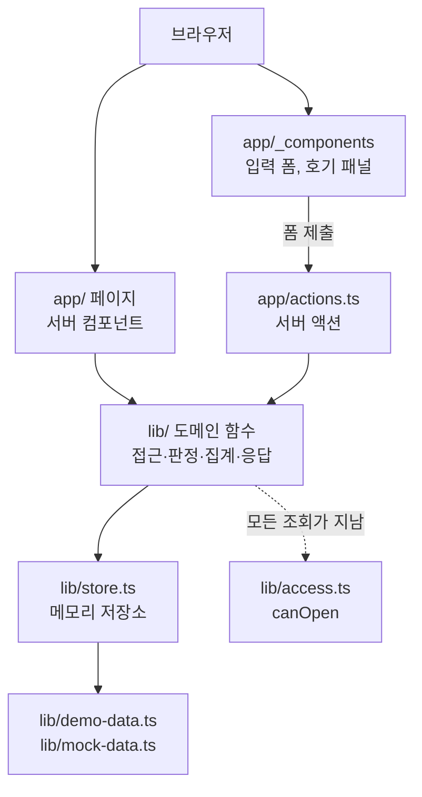

# 호기야

복성초등학교 6학년 2반 학생이 수업 직후 5문항 선진단으로 헷갈리는 개념을 찾고, 자기 수준에 맞게 복습하도록 돕는 학습 플랫폼. 과목 교사는 담당 과목의 결과를 보고 다음 수업에서 다시 다룰 개념을 정함.

- 현재 범위: 1주차, 모의 데이터. 실제 AI와 DB는 연결하지 않음
- 용어는 [CONTEXT.md](./CONTEXT.md), 요구사항은 [docs/PRD.md](./docs/PRD.md), 기능 명세는 [docs/SPEC.md](./docs/SPEC.md), 구조 결정은 [docs/adr/](./docs/adr/)를 따름

## 시작하기

```bash
pnpm install
pnpm dev          # http://localhost:3000
```

| 명령 | 용도 |
|---|---|
| `pnpm dev` | 개발 서버 (Turbopack) |
| `pnpm build` / `pnpm start` | 운영 빌드와 실행 |
| `pnpm test` | 단위 테스트 (vitest) |
| `pnpm typecheck` | 라우트 타입 생성 후 TypeScript 검사 |
| `pnpm lint` | ESLint |

- 상단 "현재 사용자"에서 교사 4명 또는 학생 1~20번으로 전환. 로그인은 없고 쿠키(`hogiya-user`)로 구분함
- 데이터는 서버 메모리에만 있음. 서버를 재시작하면 데모 데이터로 돌아감

## 기술 스택

| 영역 | 선택 | 비고 |
|---|---|---|
| 프레임워크 | Next.js 16.4.6 (App Router) | Cache Components, Partial Prefetching 사용 |
| UI | React 19.3 | 서버 컴포넌트 기본, 입력 폼만 클라이언트 컴포넌트 |
| 스타일 | Tailwind CSS 4.3 | `@tailwindcss/turbopack`로 처리 |
| 언어 | TypeScript 5 (strict) | 모의 데이터의 타입 계약을 3주차 DB에도 유지 |
| 변경 처리 | 서버 액션 (`app/actions.ts`) | 별도 API 라우트 없음 |
| 저장소 | 메모리 (`globalThis`) | 1주차 한정. 3주차에 DB로 교체 |
| 테스트 | Vitest 5 | 도메인 함수 단위 테스트 106개 |
| 품질 | ESLint 9 (`eslint-config-next`) | |
| 패키지 관리 | pnpm 11 | |

## 아키텍처

화면과 규칙을 분리한 3계층 구조. 업무 규칙은 모두 `lib/`의 함수에 있고, `app/`은 그 함수를 호출해 보여 주는 얇은 층임.



### 계층별 책임

| 계층 | 위치 | 책임 |
|---|---|---|
| 화면 | `app/**/page.tsx` | 현재 사용자 확인, 접근 판단 호출, 결과 표시. 거절하면 `notFound()` |
| 입력 | `app/_components/` | 오류를 칸별로 표시, 입력값 유지, 시도 키 생성 |
| 변경 | `app/actions.ts` | FormData를 도메인 입력으로 바꾸고 결과를 화면 상태로 변환 |
| 규칙 | `lib/*.ts` | 접근, 공개 조건, 버전, 제출, 판정, 집계, 호기 응답 |
| 저장 | `lib/store.ts` | 하나의 `Data` 객체. 3주차에 이 파일만 교체 |

### 도메인 모듈

| 모듈 | 하는 일 | 성격 |
|---|---|---|
| `access.ts` | `canOpen`, `listLessons`: 누가 무엇을 열 수 있는지 판단 | 순수 함수. 모든 화면과 조회가 지남 (S01) |
| `teaching.ts` | 수업 생성, 수업 자료 추가·수정·삭제 | `Data`를 변경 |
| `publishing.ts` | 개념과 문항 저장, 공개 조건 검사, 공개·마감, 새 버전 생성 | `Data`를 변경 |
| `attempts.ts` | 선진단 제출, 시도 키 중복 처리, 참여 횟수 | `Data`를 변경 |
| `assessment.ts` | `assess`: 개념별 이해 수준 판정 | 순수 함수. 이해 수준을 정하는 유일한 곳 (S05) |
| `review.ts` | 복습 화면 구성, 다시 설명하기 저장, 진행 상태 | 조회 위주 |
| `hogi.ts` | 호기 입력 생성과 모의 응답 | 2주차에 `respond` 안만 Claude API로 교체 (S06) |
| `dashboard.ts` | 참여 횟수, 수준별 분포, 재지도 대상 개념, 개념별 개인 답안 | 순수 함수 (S07) |
| `synthetic.ts` / `demo-data.ts` | 기대 집계가 있는 합성 시도와 화면 확인용 데이터 | 데이터 |
| `types.ts` / `result.ts` | 데이터 계약, 실패 시 칸별 안내를 담는 `Result` | 타입 |

### 디렉터리

```text
app/
  layout.tsx, page.tsx          역할 전환, 수업 목록
  actions.ts                    서버 액션 모음
  role-switcher.tsx             현재 사용자 전환
  lessons/[id]/
    page.tsx                    수업 화면 (교사: 자료·공개·마감, 학생: 풀기·결과)
    questions/page.tsx          교사: 개념과 문항 편집, 이전 버전
    diagnose/page.tsx           학생: 선진단 풀기
    dashboard/page.tsx          교사: 학급 전체 집계
    dashboard/[conceptId]/      교사: 개념별 개인 답안
  attempts/[id]/page.tsx        학생: 결과, 복습, 호기 패널
  _components/                  폼과 패널 (클라이언트 컴포넌트)
lib/                            도메인 함수와 단위 테스트(*.test.ts)
docs/                           PRD, SPEC, ADR
.scratch/                       티켓 (로컬 마크다운)
```

### 핵심 설계 결정

- **접근 판단은 한 함수**: `canOpen`이 수업, 자료, 시도, 대시보드 접근을 모두 판단함. 범위 밖 요청과 없는 대상은 같은 결과(거절)라서 존재 여부가 드러나지 않음. 3주차에 이 규칙을 RLS로 옮김
- **기록의 단위는 시도** (ADR 0002): 같은 학생이 여러 번 풀 수 있고, 시도 키로 같은 요청의 중복 기록을 막음. 참여 횟수는 모든 시도, 분포는 학생별 최근 시도 기준
- **공개 후 수정은 새 버전** (ADR 0001): 학생이 제출해서 쓰이기 시작한 문항 세트는 덮어쓰지 않고 복사해 버전을 올림. 시도는 제출 당시 버전에 연결된 채 남고, 평가 결과도 그 시점에 계산해 저장함
- **판정과 집계는 부수 효과 없는 순수 함수**: 같은 입력이면 항상 같은 결과. 이유 문장과 다시 설명하기 글은 판정과 집계에 쓰지 않음
- **호기의 입력은 제한**: 현재 개념, 그 수업의 자료, 길이를 제한한 질문만 전달. 학생 이름, 다른 학생의 답안, 다른 과목 자료는 타입상 들어갈 자리가 없음. 응답 함수가 실패해도 결과와 답안은 그대로 남음
- **개인 식별값 최소화**: 학생은 합성 ID와 번호로만 식별. 학급 전체 화면에는 번호도 보이지 않고, 개념으로 내려가야 번호와 답안이 보임

### 요청 흐름 예시: 학생의 선진단 제출

1. `diagnose/page.tsx`가 `canOpen`과 `canStartAttempt`를 확인하고 폼을 그림 (문항 서명 포함)
2. `DiagnoseForm`이 화면을 열 때 시도 키를 만들고, 제출하면 `submitAttemptAction` 호출
3. `submitAttempt`가 키 중복, 문항 서명, 미응답 문항을 검사하고 시도를 저장
4. 같은 함수에서 `assess`로 평가 결과를 계산해 시도와 함께 저장
5. 결과·복습 화면(`attempts/[id]`)으로 이동. 대시보드는 다음 요청부터 새 분포를 계산함

## 주차별 교체 지점

| 시점 | 교체 대상 | 바뀌는 곳 |
|---|---|---|
| 2주차 | 호기 응답, 승인된 자료 조회(MCP) | `lib/hogi.ts`의 `respond` 안만 |
| 3주차 | 저장소 DB 연결, 접근 규칙을 RLS로 | `lib/store.ts`, `lib/access.ts`의 규칙 |
| 3주차 | 정보 최소 수집과 삭제 | 이유 문장·다시 설명하기 입력의 개인정보 검사 |
| 4~5주차 | 평가와 개선 비교 | 교사 채점 사례와 판정 함수 비교 |

## 알려진 한계 (1주차)

- 서버 메모리 저장이라 재시작하면 데이터가 사라지고, 서버가 여러 개면 데이터가 갈라짐
- 로그인이 없어 쿠키 값만 바꾸면 다른 사용자가 됨. 모의 데이터 단계에서만 허용
- 호기의 설명은 시드 개념 2개에만 미리 써 둠
- 개념 이름과 확인 활동 안내는 버전 없이 제자리에서 고쳐짐
- 학생이 쓴 글의 개인정보 검사는 없음 (3주차)
